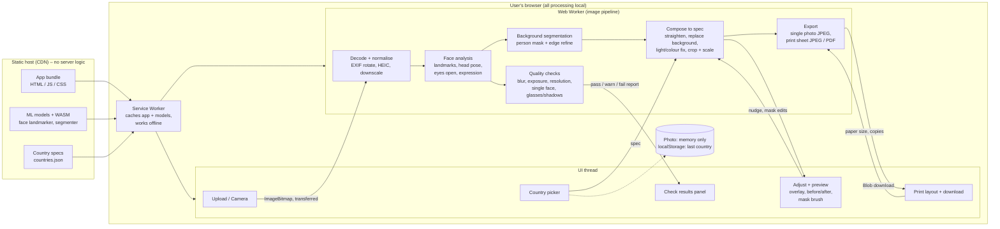
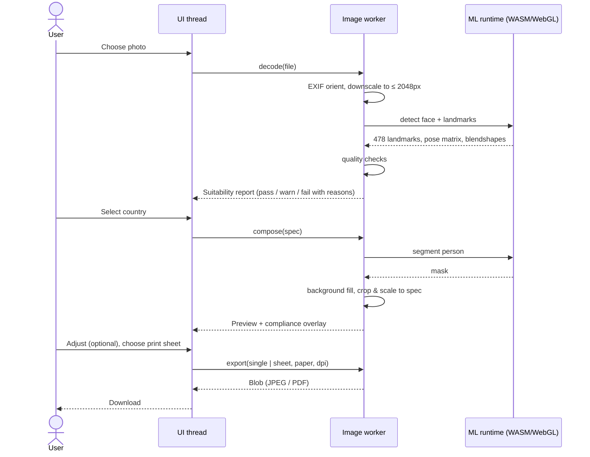

# On-browser Passport Photo: Architecture and Tech Stack

Status: proposal, 2026-10-08. Based on the functionality described in the project chat (upload, suitability check, country selection, country-specific alteration, printable grid). Checked against the [functionality doc](https://claude.ai/code/artifact/1f8c57ee-7cf3-4653-86ff-12192f6cc1cf) on 2026-10-08; section numbers like F4 refer to it.

**Hard constraint:** the photo never leaves the device. There is no backend. The app is a static site; every model, WASM binary and country spec is served from the same origin and runs in the browser.

Diagram files: [`architecture.png`](architecture.png) / [`architecture.svg`](architecture.svg) (component view) and [`sequence.svg`](sequence.svg) (request flow). Sources are the Mermaid blocks below.

---

## 1. High-level architecture



### Request flow (sequence)



---

## 2. Components

### 2.1 Input and normalisation
- Accept JPEG, PNG, WebP, and HEIC (iPhone), up to 20 MB, via file picker, drag and drop, clipboard paste, or live camera capture (`getUserMedia`) with a face-outline guide (F1).
- Respect EXIF orientation (`createImageBitmap(file, { imageOrientation: 'from-image' })`).
- Keep the full-resolution original for the final render; run analysis on a downscaled copy (≈1024–2048 px long edge) for speed.

### 2.2 Suitability check ("can this photo be used?")
Runs before the user picks a country, then re-scored against the chosen spec. Each check returns pass / warn / fail with a human reason.

| Check | Method |
|---|---|
| Exactly one face | Face landmarker face count |
| Face large enough / enough resolution | Inter-pupil distance and face box in px vs. what the target spec needs at 300 DPI |
| Head tilt / turn | Yaw, pitch, roll from the landmarker's facial transformation matrix (e.g. fail beyond ±8–10°) |
| Eyes open, neutral mouth | Blendshapes (`eyeBlinkLeft/Right`, `jawOpen`, `mouthSmile*`) |
| Whole head in frame | Landmark bounds + estimated crown/chin margin vs. image edges |
| Sharpness | Variance of Laplacian on the face region |
| Exposure / even lighting | Luminance histogram; left vs. right face brightness ratio for side shadows |
| Background separable | Segmentation mask confidence along the hair/shoulder edge |
| Glasses, headwear (warn only) | Heuristics initially; optional small classifier later |

### 2.3 Country specs (data, not code)
A versioned `countries.json`, so adding a country is a data change. Example shape:

```json
{
  "id": "gb",
  "name": "United Kingdom",
  "photo": { "widthMm": 35, "heightMm": 45 },
  "head": { "chinToCrownMm": [29, 34] },
  "eyeLine": { "fromBottomMm": null },
  "background": { "color": "#EEEEEE", "allowed": ["light grey", "cream"] },
  "dpi": 600,
  "digital": { "widthPx": null, "maxKB": null },
  "rules": { "glasses": "discouraged", "smile": false },
  "source": "https://www.gov.uk/photos-for-passports",
  "verified": "YYYY-MM-DD"
}
```

Starter list (values must be verified against each official source before shipping): United States (2×2 in), United Kingdom, Schengen / EU (35×45 mm), India, Canada, Australia. Every entry carries its official source URL and a last-verified date.

### 2.4 Background replacement
1. Person mask from a segmentation model (hair, face, body, clothes classes).
2. Refine the edge: feather / guided filter on the mask, so hair isn't cut hard.
3. Composite over the spec's background colour. Optional mild colour decontamination at the edge so the old background doesn't halo.

### 2.5 Straighten, correct light, crop and scale (F4)
- Rotate so the eyes are level (roll angle from the eye landmarks), before cropping.
- Gentle exposure and white-balance correction on the person region only. No skin smoothing, reshaping or filters.
- Estimate crown (top of head) from the segmentation mask above the forehead landmarks; chin from landmarks.
- Scale so chin-to-crown hits the middle of the spec's allowed range; position so the eye line / top margin matches the spec; centre on the face midline.
- Render the output at the spec's physical size and DPI from the **full-resolution original** (single resample, high-quality smoothing).
- Re-run the suitability check on the composed result and show new warnings next to it.
- Adjust screen (F5): overlay of head-height band and eye line, before/after toggle, zoom/move/rotate/brightness clamped to the spec's range, and a keep/remove brush that edits the segmentation mask before re-compositing. Reset returns to the automatic result.

### 2.6 Print sheet
- Paper presets: 4×6 in (10×15 cm), 5×7 in, A4, Letter; 300 DPI default.
- Tile as many copies as fit with cut guides and a small gutter; optional "fill sheet" vs. fixed count.
- Export JPEG (photo-lab friendly) and PDF at true physical size (prints 1:1 with "Actual size").

---

## 3. Proposed tech stack

| Layer | Choice | Why | Alternatives |
|---|---|---|---|
| Language / build | **TypeScript + Vite** | Fast dev, easy worker + WASM asset handling | — |
| UI framework | **React** (or **Svelte** for a smaller bundle) | Large ecosystem for crop/file components | Svelte, Preact, Vue |
| Styling | Tailwind CSS | Quick, consistent UI | CSS modules |
| Face detection + landmarks | **MediaPipe Tasks Vision – `FaceLandmarker`** (`@mediapipe/tasks-vision`) | 478 landmarks, head-pose matrix and blendshapes in one model; WASM + WebGL/GPU; ~4 MB | `face-api.js` (older), `@tensorflow-models/face-landmarks-detection` |
| Person segmentation | **MediaPipe `ImageSegmenter` (selfie multiclass)** | Same runtime, separates hair/face/body/background, small | **`@imgly/background-removal`** (ONNX, higher-quality hair edges, but ~40–80 MB model); MODNet / RMBG via ONNX |
| Custom models (later) | ONNX Runtime Web (WebGPU / WASM) | Run any extra classifier (glasses, hat) | TensorFlow.js |
| Off-main-thread work | **Web Worker + OffscreenCanvas**, **Comlink** for RPC | Keeps UI responsive during inference | — |
| Image ops | Canvas 2D / OffscreenCanvas; hand-written Laplacian + histogram on `ImageData` | Avoids shipping OpenCV.js (~8 MB) | OpenCV.js if checks grow complex |
| HEIC decode | `heic2any` (or `libheif-js`) | iPhone photos | — |
| EXIF / metadata | `exifr` | Orientation, camera info; strip on export | — |
| Manual crop UI | `react-easy-crop` | Pinch/zoom/drag on mobile | Cropper.js |
| PDF print sheet | **`pdf-lib`** | Exact mm/inch page sizes, embeds JPEG losslessly | jsPDF |
| Offline / caching | **`vite-plugin-pwa`** (Workbox) | Caches models after first load, installable | — |
| Local persistence | `localStorage` for last country only | Photo must not persist (F7) | — |
| Country specs validation | `zod` | Validates `countries.json` at build time | — |
| Testing | Vitest (pipeline units), Playwright (end-to-end with fixture photos) | Regression on real images per country | — |
| Hosting | Any static host: Cloudflare Pages, Netlify, GitHub Pages | No backend needed | — |

### Privacy and security
- Strict Content-Security-Policy: `connect-src 'self'`, no third-party scripts, no analytics on image data. Self-host all model files and WASM rather than loading them from a public CDN at runtime.
- Images live in memory (`ImageBitmap` / `Blob`) only and are released on "Clear photo", tab close or refresh (F7). The only thing stored is the last chosen country, in `localStorage`.
- Strip EXIF (including GPS) from exported files.
- Optional COOP/COEP headers to enable multithreaded WASM (`SharedArrayBuffer`) for faster inference.

### Performance budget
- First load: app shell < 300 KB gzipped; models (~5–10 MB with MediaPipe) lazy-loaded after upload starts, then cached by the service worker.
- Target < 2 s from upload to suitability report on a mid-range phone; WebGPU/WebGL delegate where available, WASM fallback otherwise.

---

## 4. Suggested module layout

```
src/
  app/              UI routes/components (upload, country, check, adjust, print)
  pipeline/         runs in the worker
    decode.ts       file -> ImageBitmap (EXIF, HEIC, downscale)
    face.ts         MediaPipe FaceLandmarker wrapper -> landmarks, pose, blendshapes
    checks.ts       suitability rules -> CheckReport
    segment.ts      person mask + edge refine
    compose.ts      background fill, crop/scale to spec
    export.ts       single JPEG, print sheet JPEG/PDF
    worker.ts       Comlink-exposed API
  specs/
    countries.json  country rules (data)
    schema.ts       zod schema
  lib/units.ts      mm/inch/px conversions at a given DPI
public/models/      self-hosted .task / .onnx / .wasm files
```

## 5. Open questions
Country list and digital-upload sizes are tracked as open questions in the functionality doc (F8). One architecture-specific question remains:

1. Is MediaPipe segmentation quality good enough on hair, or should the heavier `@imgly/background-removal` model be offered as an "HD" option?
